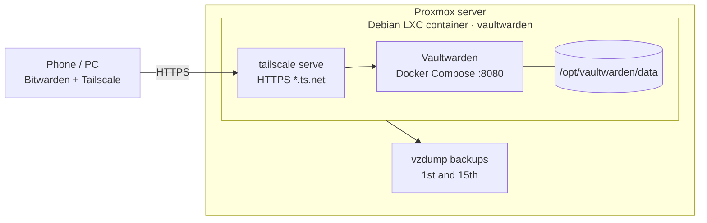

# Vaultwarden on Proxmox with ProxMenux, Docker and Tailscale

**English** | [Español](README.es.md)


Complete documentation of a self-hosted password manager: **Vaultwarden** running in Docker inside a **Proxmox** LXC container created with **ProxMenux**, published over HTTPS only inside a private **Tailscale** network, and used from the official **Bitwarden** apps.

The guide is written step by step, in the real order the setup was built, and includes **the errors that came up during installation**, with their cause and fix.

## What this project does

- Vaultwarden runs 24/7 in a container on a home Proxmox server.
- Passwords are used from the Bitwarden web vault, browser extensions, desktop app and mobile app.
- All access goes through a private Tailscale network with HTTPS: no ports are open to the internet.
- Other people can have their own account if the server is shared with them in Tailscale.
- Proxmox backs up the whole container on the 1st and 15th of every month.

## Contents

- [Architecture](#architecture)
- [Components](#components)
- [Placeholders used in this guide](#placeholders-used-in-this-guide)
- [1. First attempt and DNS problem](#1-first-attempt-and-dns-problem)
- [2. Creating the LXC with ProxMenux](#2-creating-the-lxc-with-proxmenux)
- [3. Deploying Vaultwarden with Docker Compose](#3-deploying-vaultwarden-with-docker-compose)
- [4. HTTPS with Tailscale](#4-https-with-tailscale)
- [5. Accounts, sign-ups and Bitwarden clients](#5-accounts-sign-ups-and-bitwarden-clients)
- [6. Protection, auto-start and backups](#6-protection-auto-start-and-backups)
- [7. Maintenance](#7-maintenance)
- [Appendix: admin panel](#appendix-admin-panel-optional)
- [Troubleshooting](#troubleshooting)
- [Lessons learned](#lessons-learned)
- [Security](#security)
- [Projects used](#projects-used)

## Architecture



Requests arrive over HTTPS at `tailscale serve`, which forwards them to Vaultwarden on port 8080. Proxmox takes care of backing up the whole container.

## Components

| Component | Role | Cost |
| --- | --- | --- |
| Proxmox VE | Hypervisor that hosts the container and schedules backups | Free |
| ProxMenux | Menu that runs the Helper Script to create the LXC with Docker | Free (MIT) |
| Unprivileged Debian 13 LXC | Lightweight container with *nesting* enabled for Docker | Free |
| Docker Compose | Runs the `vaultwarden/server` image | Free |
| Vaultwarden | Bitwarden-compatible server written in Rust | Free (AGPL-3.0) |
| Tailscale | Private access and an HTTPS certificate via `tailscale serve` | Free (personal plan) |
| Bitwarden apps | Web, extensions, desktop and mobile in *Self-hosted* mode | Free |

## Placeholders used in this guide

The documentation contains no personal data. Wherever you need your own value, these placeholders are used:

| Placeholder | What it stands for |
| --- | --- |
| `<ID>` | The container number in Proxmox (for example, `101`) |
| `vaultwarden.tu-red.ts.net` | The HTTPS address assigned by Tailscale |
| `vaultwarden` | Container name used in the examples |

## 1. First attempt and DNS problem

The first container could not download packages because it could not resolve domain names, so it was deleted and created again with ProxMenux.

Error when running `apt update && apt install -y curl` inside the LXC:

```text
Error: Failed to fetch http://deb.debian.org/debian/pool/main/c/curl/curl_8.14.1-2+deb13u4_amd64.deb  Temporary failure resolving 'deb.debian.org'
Error: Unable to fetch some archives, maybe run apt-get update or try with --fix-missing?
```

**Diagnosis inside the container:**

```bash
ip a                  # does eth0 have an IP?
ip route              # is there a "default via ..." line?
ping -c 3 1.1.1.1     # is there internet access?
ping -c 3 google.com  # does DNS work?
cat /etc/resolv.conf  # is there a nameserver line?
```

**Fix in Proxmox:**

1. Container → **Network → net0**: bridge `vmbr0` and IPv4 set to **DHCP**, or a static IP with the router as gateway.
2. Container → **DNS**: server `1.1.1.1` or the router's IP.
3. Node → **System → DNS**: make sure the host has a valid DNS (`ping -c 3 google.com` from the host shell).

**Deleting the failed container** (node shell):

```bash
pct list
pct stop <ID>
pct destroy <ID> --purge
```

## 2. Creating the LXC with ProxMenux

The container is created with the **Docker (Debian)** Helper Script launched from ProxMenux, in **Advanced settings** mode.

**Install and open ProxMenux** (node shell):

```bash
ping -c 3 google.com   # the host must have internet before starting
bash -c "$(wget -qLO - https://raw.githubusercontent.com/MacRimi/ProxMenux/main/install_proxmenux.sh)"
menu
```

**In the menu:**

1. Open **Helper Scripts** (depending on the version, *Essential Proxmox VE Helper Scripts*).
2. Search for **Docker**, choose the **Debian** variant and download from **GitHub**.
3. Choose **Advanced settings** and answer as follows:

| Screen | Answer | Reason |
| --- | --- | --- |
| Container type | Unprivileged | More isolation from the host |
| Hostname | `vaultwarden` | Container name and Tailscale machine name |
| Disk / CPU / RAM | 8–10 GB, 1–2 cores, 1024–2048 MB | Vaultwarden uses very few resources |
| Bridge / IPv4 | `vmbr0` / DHCP or static IP with gateway | Avoids repeating the network failure |
| DNS server | `1.1.1.1` or the router's IP | Avoids repeating the DNS failure |
| SSH access | No | Managed with `pct enter` or the web console |
| FUSE support | No | Only for rclone, mergerfs or AppImage |
| TUN/TAP support | Yes | Required for Tailscale inside the container |
| Nesting | Yes | Required for Docker |
| GPU passthrough | No | Vaultwarden does not use a GPU |
| APT Cacher-NG proxy | No | No apt-cacher-ng server on the network |
| HTTP/HTTPS proxy | No | Only for corporate networks |
| Container protection | No | Enabled at the end, once everything works |
| Console mode | shell | Logs in as root and allows multi-line paste |
| Device node creation (mknod) | No | Not needed |
| Mount filesystems | Empty | No NFS or CIFS mounts |
| Post-install hook | Empty | No extra scripts on the host |
| Verbose mode | Yes | Shows the full error if something fails |
| Save as defaults | No | Avoids inheriting the name and IP in future containers |

> During installation the script upgrades system packages (for example `python3.13-minimal`). It can take a while; it is only a problem if the container's CPU and disk stay idle for a long time.

**Check Docker inside the container:**

```bash
pct enter <ID>
docker compose version
```

## 3. Deploying Vaultwarden with Docker Compose

**Create the folder and `compose.yml`** (inside the LXC):

```bash
mkdir -p /opt/vaultwarden && cd /opt/vaultwarden

cat > compose.yml <<'EOF'
services:
  vaultwarden:
    image: vaultwarden/server:latest
    container_name: vaultwarden
    restart: unless-stopped
    environment:
      DOMAIN: "https://vaultwarden.tu-red.ts.net"
      SIGNUPS_ALLOWED: "true"
    volumes:
      - ./data:/data
    ports:
      - "8080:80"
EOF
```

At first `DOMAIN` holds a placeholder value; it is replaced with the Tailscale address in step 4. The `/admin` panel is left disabled on purpose (see the [appendix](#appendix-admin-panel-optional)).

**Start and check:**

```bash
docker compose up -d
docker compose ps                          # vaultwarden should be Up / running
docker compose logs --tail=20 vaultwarden
curl -I http://localhost:8080              # should return HTTP/1.1 200 OK
```

## 4. HTTPS with Tailscale

Bitwarden apps require HTTPS. Tailscale provides a valid certificate on a `*.ts.net` address that only devices in your Tailscale network can reach.

**Check that the container has TUN:**

```bash
ls /dev/net/tun
```

If it does not exist, add it from the Proxmox node shell:

```bash
echo "lxc.cgroup2.devices.allow: c 10:200 rwm" >> /etc/pve/lxc/<ID>.conf
echo "lxc.mount.entry: /dev/net/tun dev/net/tun none bind,create=file" >> /etc/pve/lxc/<ID>.conf
pct reboot <ID>
pct enter <ID>
```

**Install Tailscale and publish Vaultwarden** (inside the LXC):

```bash
curl -fsSL https://tailscale.com/install.sh | sh
tailscale up               # open the link and sign in to your Tailscale account
tailscale serve --bg 8080  # if it asks to enable HTTPS, open the link and enable it
tailscale serve status     # shows the address https://vaultwarden.tu-red.ts.net
```

**Set the address in `DOMAIN` and apply:**

```bash
cd /opt/vaultwarden
nano compose.yml           # DOMAIN: "https://vaultwarden.tu-red.ts.net"
docker compose up -d
grep DOMAIN compose.yml    # must match tailscale serve status exactly
```

On every PC or phone that will use Vaultwarden, install Tailscale and sign in with the same account.

## 5. Accounts, sign-ups and Bitwarden clients

**Create the account:** open `https://vaultwarden.tu-red.ts.net`, click **Create account** and choose a long master password.

> ⚠️ The master password **cannot be recovered**. Also keep it on paper in a safe place.

**Open sign-ups (`SIGNUPS_ALLOWED: "true"`):** they are left open because only devices in the Tailscale network can reach the server.

- To give someone access: in the Tailscale admin console, **Machines → ⋯ → Share** on the container. That person only sees this server.
- The administrator cannot see or recover other users' passwords: each vault is encrypted with its own master password.
- If the server is ever published on the internet with a domain, close sign-ups:

```bash
cd /opt/vaultwarden
sed -i 's/SIGNUPS_ALLOWED: "true"/SIGNUPS_ALLOWED: "false"/' compose.yml
docker compose up -d
```

**Connect the Bitwarden apps** (extension, desktop and mobile):

1. Install Tailscale on the device and sign in.
2. Install the official **Bitwarden** app or extension.
3. On the login screen, change *"Accessing: bitwarden.com"* to **Self-hosted** and enter `https://vaultwarden.tu-red.ts.net` as the **Server URL**.
4. Log in with the Vaultwarden account (not a bitwarden.com account).

**Import passwords:** in the Vaultwarden web vault, **Tools → Import data**.

- From Chrome: export at `chrome://password-manager/settings` and import with the **Chrome (csv)** format.
- From your own notes: create a **Bitwarden (csv)** file saved as UTF-8 from Notepad (not from Excel, which uses `;` in Spanish locales):

```csv
folder,favorite,type,name,notes,fields,reprompt,login_uri,login_username,login_password,login_totp
,,login,Gmail,,,,https://accounts.google.com,myemail@gmail.com,"MyPassword123",
,,login,Bank,,,,https://mybank.com,user123,"Password,with,commas",
```

After importing, delete the `.csv` file and the original notes, and empty the recycle bin.

**Two-step login:** in the Vaultwarden web vault, **Settings → Security → Two-step login → Authenticator app**. Save the recovery code.

## 6. Protection, auto-start and backups

**Deletion protection** (node shell). Prevents deleting the container or restoring a backup over it; it does not stop shutdowns or protect against disk failure.

```bash
pct set <ID> --protection 1   # to delete it some day: --protection 0
```

**Auto-start:** container → **Options → Start at boot → Yes**. After rebooting the container, `https://vaultwarden.tu-red.ts.net` should load again on its own within a minute.

**Tailscale key expiry:** Tailscale admin console → **Machines → ⋯ → Disable key expiry** on the container. Otherwise it disconnects after 180 days.

**Manual test backup:** container → **Backup → Backup now**, **Snapshot** mode, **ZSTD** compression. It should finish with `TASK OK`.

**Scheduled backup** (**Datacenter → Backup → Add**):

| Field | Value |
| --- | --- |
| Storage | Storage with *VZDump backup file* content, ideally on another disk or a NAS |
| Schedule | `*-1,15 03:00` (1st and 15th at 3:00; check it in **Schedule Simulator**) |
| Selection mode | *Include selected VMs* → the Vaultwarden container |
| Compression / Mode | ZSTD / Snapshot |
| Retention | Uncheck *Keep all backups*; **Keep Last** 1 or 2 |

**Restore test:** storage → **Backups → Restore** with a free ID (for example `999`), without starting it so the IP and Tailscale name are not duplicated. Then:

```bash
pct destroy 999 --purge
```

**Off-server copy:** in the Vaultwarden web vault, **Tools → Export vault → .json (Encrypted)**, saved to a USB drive.

## 7. Maintenance

Once a month, after a manual **Backup now**:

```bash
pct enter <ID>
apt update && apt upgrade -y
cd /opt/vaultwarden && docker compose pull && docker compose up -d
```

## Appendix: admin panel (optional)

The `/admin` panel is used to manage users, invitations and SMTP email. It stays disabled until `ADMIN_TOKEN` is set.

```bash
docker run --rm -it vaultwarden/server /vaultwarden hash --preset owasp
```

Add the hash to `compose.yml`, writing every `$` as `$$`:

```yaml
      ADMIN_TOKEN: '$$argon2id$$v=19$$m=65540,t=3,p=4$$xxxx$$yyyy'
```

Apply with `docker compose up -d` and open `https://vaultwarden.tu-red.ts.net/admin` with the password you typed (not the hash).

## Troubleshooting

| Symptom | Cause | Fix |
| --- | --- | --- |
| `Temporary failure resolving 'deb.debian.org'` | The LXC had no network or DNS configured | Network on DHCP with `vmbr0`, DNS `1.1.1.1`; check the host's DNS |
| Installation keeps repeating `Unpacking python3.13-minimal` | Slow or stuck package upgrade | Check CPU and disk in *Summary*; if idle at 0 %, Ctrl+C, delete and retry |
| Web vault or apps cannot connect | No HTTPS, or `DOMAIN` does not match | `tailscale serve status` and `grep DOMAIN compose.yml` must show the same address |
| The app saves to bitwarden.com | The client points to the Bitwarden cloud | Log out, choose *Self-hosted* and enter the `*.ts.net` URL |
| `/dev/net/tun` does not exist | TUN/TAP disabled when the LXC was created | Add the two `lxc.*` lines to `/etc/pve/lxc/<ID>.conf` and reboot |

## Lessons learned

- **Network first, everything else after.** The first attempt failed because the container could not resolve DNS. A `ping -c 3 google.com` on the host and in the LXC saves a reinstall.
- **"Advanced settings" in the Helper Script pays off.** It lets you set DNS, TUN/TAP and nesting from the start instead of fixing them later.
- **Vaultwarden needs HTTPS, no exceptions.** Without it you cannot create an account in the web vault or connect the apps. `tailscale serve` solves it without opening ports or buying a domain.
- **`DOMAIN` must match exactly** the address shown by `tailscale serve status`.
- **Bitwarden apps connect to bitwarden.com by default.** Choose *Self-hosted* before logging in, or your passwords end up in the Bitwarden cloud.
- **Tailscale expires keys after 180 days.** On a server, disable key expiry or it silently becomes unreachable.
- **In Docker Compose, `$` is written `$$`.** This affects the `ADMIN_TOKEN` hash.
- **Excel in Spanish saves CSV files with `;`.** For imports, Notepad with UTF-8 is more reliable.
- **Container protection goes on at the end.** During installation it only gets in the way if you need to delete and retry.

## Security

- No ports are opened on the router. Access goes through Tailscale with HTTPS.
- Sign-ups are open, but only devices in the Tailscale network (or people the machine is shared with) can reach the server.
- The `/admin` panel stays disabled until `ADMIN_TOKEN` is set.
- Vaults are end-to-end encrypted: not even the server administrator can read them.
- Two-step login is enabled and the recovery code is stored off the server.
- Import CSV files are deleted after use.

## Projects used

- [Vaultwarden](https://github.com/dani-garcia/vaultwarden)
- [Bitwarden](https://bitwarden.com/download/)
- [ProxMenux](https://github.com/MacRimi/ProxMenux)
- [Proxmox VE Helper-Scripts](https://github.com/community-scripts/ProxmoxVE)
- [Tailscale](https://tailscale.com)
- [Proxmox VE](https://www.proxmox.com)

> Vaultwarden, ProxMenux and the Helper Scripts are updated frequently. If a menu or command does not match this guide, check each project's official documentation.
