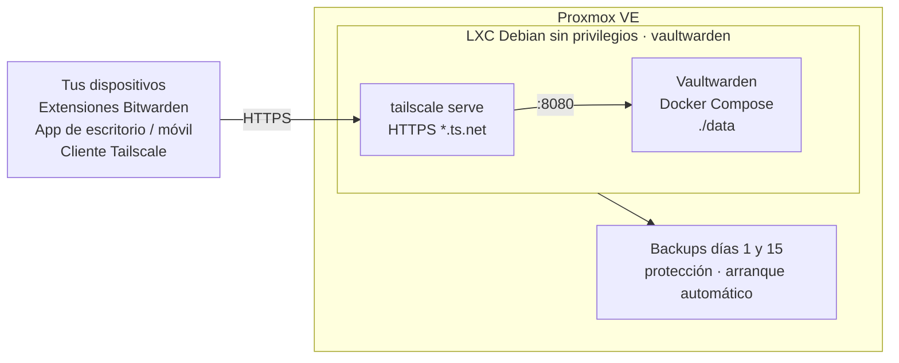

# Vaultwarden en Proxmox con ProxMenux, Docker y Tailscale

Gestor de contraseñas autoalojado: **Vaultwarden** en Docker, dentro de un contenedor **LXC de Debian** creado con **ProxMenux** en **Proxmox VE**. Solo se publica con HTTPS dentro de una red privada de **Tailscale** y se usa desde las apps oficiales de **Bitwarden** en modo *Self-hosted*.

> En esta guía, `<ID>` es el número del contenedor en Proxmox y `vaultwarden.tu-red.ts.net` representa la dirección real de Tailscale. Sustitúyelos por tus valores.

## Índice

- [Arquitectura](#arquitectura)
- [1. Primer intento y problema de DNS](#1-primer-intento-y-problema-de-dns)
- [2. Creación del LXC con ProxMenux](#2-creación-del-lxc-con-proxmenux)
- [3. Despliegue de Vaultwarden con Docker Compose](#3-despliegue-de-vaultwarden-con-docker-compose)
- [4. HTTPS con Tailscale](#4-https-con-tailscale)
- [5. Cuentas, registros y clientes Bitwarden](#5-cuentas-registros-y-clientes-bitwarden)
- [6. Protección, arranque automático y copias de seguridad](#6-protección-arranque-automático-y-copias-de-seguridad)
- [7. Mantenimiento](#7-mantenimiento)
- [Anexo: panel de administración](#anexo-panel-de-administración-opcional)
- [Problemas encontrados y soluciones](#problemas-encontrados-y-soluciones)

## Arquitectura



| Componente | Función |
| --- | --- |
| Proxmox VE | Hipervisor donde vive el contenedor y donde se programan las copias de seguridad |
| ProxMenux | Menú que lanza el Helper Script de la comunidad para crear el LXC con Docker |
| LXC Debian sin privilegios | Contenedor ligero con *nesting* activado para poder ejecutar Docker |
| Docker Compose | Ejecuta la imagen `vaultwarden/server` y guarda los datos en `/opt/vaultwarden/data` |
| Tailscale | Acceso privado y certificado HTTPS válido con `tailscale serve` |
| Clientes Bitwarden | Web, extensiones, escritorio y móvil configurados como *Self-hosted* |

## 1. Primer intento y problema de DNS

El primer contenedor no podía descargar paquetes porque no resolvía nombres de dominio, así que se borró y se volvió a crear con ProxMenux.

Error al ejecutar `apt update && apt install -y curl` dentro del LXC:

```text
Error: Failed to fetch http://deb.debian.org/debian/pool/main/c/curl/curl_8.14.1-2+deb13u4_amd64.deb  Temporary failure resolving 'deb.debian.org'
Error: Unable to fetch some archives, maybe run apt-get update or try with --fix-missing?
```

**Diagnóstico dentro del contenedor:**

```bash
ip a                  # ¿eth0 tiene IP?
ip route              # ¿hay una línea "default via ..."?
ping -c 3 1.1.1.1     # ¿hay salida a internet?
ping -c 3 google.com  # ¿funciona el DNS?
cat /etc/resolv.conf  # ¿hay alguna línea nameserver?
```

**Solución en Proxmox:**

1. Contenedor → **Network → net0**: bridge `vmbr0` e IPv4 en **DHCP**, o una IP fija con la puerta de enlace del router.
2. Contenedor → **DNS**: servidor `1.1.1.1` o la IP del router.
3. Nodo → **System → DNS**: comprobar que el host tiene un DNS válido (`ping -c 3 google.com` desde la shell del host).

**Borrado del contenedor fallido** (shell del nodo):

```bash
pct list
pct stop <ID>
pct destroy <ID> --purge
```

## 2. Creación del LXC con ProxMenux

El contenedor se crea con el Helper Script **Docker (Debian)** lanzado desde ProxMenux, en modo **Advanced settings**.

**Instalar y abrir ProxMenux** (shell del nodo):

```bash
ping -c 3 google.com   # el host debe tener internet antes de empezar
bash -c "$(wget -qLO - https://raw.githubusercontent.com/MacRimi/ProxMenux/main/install_proxmenux.sh)"
menu
```

**En el menú:**

1. Entrar en **Helper Scripts** (según la versión, *Essential Proxmox VE Helper Scripts*).
2. Buscar **Docker**, elegir la variante **Debian** y la descarga desde **GitHub**.
3. Elegir **Advanced settings** y responder así:

| Pantalla | Respuesta | Motivo |
| --- | --- | --- |
| Container type | Unprivileged | Más aislamiento respecto al host |
| Hostname | `vaultwarden` | Nombre del contenedor y de la máquina en Tailscale |
| Disco / CPU / RAM | 8–10 GB, 1–2 núcleos, 1024–2048 MB | Vaultwarden consume muy poco |
| Bridge / IPv4 | `vmbr0` / DHCP o IP fija con gateway | Evita repetir el fallo de red |
| DNS server | `1.1.1.1` o la IP del router | Evita repetir el fallo de DNS |
| SSH access | No | Se administra con `pct enter` o la consola web |
| FUSE support | No | Solo para rclone, mergerfs o AppImage |
| TUN/TAP support | Yes | Necesario para Tailscale dentro del contenedor |
| Nesting | Yes | Obligatorio para Docker |
| GPU passthrough | No | Vaultwarden no usa GPU |
| APT Cacher-NG proxy | No | No hay servidor apt-cacher-ng en la red |
| HTTP/HTTPS proxy | No | Solo para redes corporativas |
| Container protection | No | Se activa al final, cuando todo funciona |
| Console mode | shell | Entra como root y permite pegar varias líneas |
| Device node creation (mknod) | No | No hace falta |
| Mount filesystems | Vacío | No se montan NFS ni CIFS |
| Post-install hook | Vacío | Sin scripts adicionales en el host |
| Verbose mode | Yes | Muestra el error completo si algo falla |
| Guardar como valores por defecto | No | Evita heredar nombre e IP en futuros contenedores |

> Durante la instalación el script actualiza los paquetes del sistema (por ejemplo `python3.13-minimal`). Puede tardar; solo es un problema si la CPU y el disco del contenedor se quedan sin actividad durante mucho tiempo.

**Comprobar Docker dentro del contenedor:**

```bash
pct enter <ID>
docker compose version
```

## 3. Despliegue de Vaultwarden con Docker Compose

**Crear la carpeta y el `compose.yml`** (dentro del LXC):

```bash
mkdir -p /opt/vaultwarden && cd /opt/vaultwarden

cat > compose.yml <<'EOF'
services:
  vaultwarden:
    image: vaultwarden/server:latest
    container_name: vaultwarden
    restart: unless-stopped
    environment:
      DOMAIN: "https://vaultwarden.tu-red.ts.net"
      SIGNUPS_ALLOWED: "true"
    volumes:
      - ./data:/data
    ports:
      - "8080:80"
EOF
```

Al principio `DOMAIN` lleva un valor provisional y se cambia por la dirección de Tailscale en el paso 4. El panel `/admin` queda desactivado a propósito (ver el [anexo](#anexo-panel-de-administración-opcional)).

**Arrancar y comprobar:**

```bash
docker compose up -d
docker compose ps                          # vaultwarden en estado Up / running
docker compose logs --tail=20 vaultwarden
curl -I http://localhost:8080              # debe responder HTTP/1.1 200 OK
```

## 4. HTTPS con Tailscale

Las apps de Bitwarden exigen HTTPS. Tailscale da un certificado válido en una dirección `*.ts.net`, accesible solo desde los dispositivos de tu red de Tailscale.

**Comprobar que el contenedor tiene TUN:**

```bash
ls /dev/net/tun
```

Si no existe, añadirlo desde la shell del nodo de Proxmox:

```bash
echo "lxc.cgroup2.devices.allow: c 10:200 rwm" >> /etc/pve/lxc/<ID>.conf
echo "lxc.mount.entry: /dev/net/tun dev/net/tun none bind,create=file" >> /etc/pve/lxc/<ID>.conf
pct reboot <ID>
pct enter <ID>
```

**Instalar Tailscale y publicar Vaultwarden** (dentro del LXC):

```bash
curl -fsSL https://tailscale.com/install.sh | sh
tailscale up               # abrir el enlace e iniciar sesión en tu cuenta de Tailscale
tailscale serve --bg 8080  # si pide activar HTTPS, abrir el enlace y activarlo
tailscale serve status     # muestra la dirección https://vaultwarden.tu-red.ts.net
```

**Poner la dirección en `DOMAIN` y aplicar:**

```bash
cd /opt/vaultwarden
nano compose.yml           # DOMAIN: "https://vaultwarden.tu-red.ts.net"
docker compose up -d
grep DOMAIN compose.yml    # debe coincidir exactamente con tailscale serve status
```

En cada PC o móvil que vaya a usar Vaultwarden, instalar Tailscale e iniciar sesión con la misma cuenta.

## 5. Cuentas, registros y clientes Bitwarden

**Crear la cuenta:** abrir `https://vaultwarden.tu-red.ts.net`, pulsar **Crear cuenta** y elegir una contraseña maestra larga.

> ⚠️ La contraseña maestra **no se puede recuperar**. Guárdala también en papel en un lugar seguro.

**Registros abiertos (`SIGNUPS_ALLOWED: "true"`):** se dejan abiertos porque solo puede llegar al servidor quien esté en la red de Tailscale.

- Para dar acceso a otra persona: en el panel de Tailscale, **Machines → ⋯ → Share** sobre el contenedor. Esa persona solo ve este servidor.
- El administrador no puede ver ni recuperar las contraseñas de otros usuarios: cada caja fuerte va cifrada con su propia contraseña maestra.
- Si algún día se publica con un dominio en internet, cerrar los registros:

```bash
cd /opt/vaultwarden
sed -i 's/SIGNUPS_ALLOWED: "true"/SIGNUPS_ALLOWED: "false"/' compose.yml
docker compose up -d
```

**Conectar las apps de Bitwarden** (extensión, escritorio y móvil):

1. Instalar Tailscale en el dispositivo e iniciar sesión.
2. Instalar la app o extensión oficial de **Bitwarden**.
3. En la pantalla de inicio de sesión, cambiar *"Accediendo a: bitwarden.com"* por **Self-hosted** y poner `https://vaultwarden.tu-red.ts.net` como **Server URL**.
4. Iniciar sesión con la cuenta de Vaultwarden (no con una cuenta de bitwarden.com).

**Importar contraseñas:** en la web de Vaultwarden, **Herramientas → Importar datos**.

- Desde Chrome: exportar en `chrome://password-manager/settings` e importar con el formato **Chrome (csv)**.
- Desde notas propias: crear un archivo con formato **Bitwarden (csv)**, guardado en UTF-8 desde el Bloc de notas (no desde Excel, que en español usa `;`):

```csv
folder,favorite,type,name,notes,fields,reprompt,login_uri,login_username,login_password,login_totp
,,login,Gmail,,,,https://accounts.google.com,micorreo@gmail.com,"MiContraseña123",
,,login,Banco,,,,https://mibanco.com,usuario123,"Clave,con,comas",
```

Después de importar, borrar el `.csv` y las notas originales y vaciar la papelera.

**Verificación en dos pasos:** en la web de Vaultwarden, **Configuración → Seguridad → Inicio de sesión en dos pasos → App de autenticación**. Guardar el código de recuperación.

## 6. Protección, arranque automático y copias de seguridad

**Protección contra borrado** (shell del nodo). Impide eliminar el contenedor o restaurar una copia encima; no impide apagarlo ni protege contra fallos de disco.

```bash
pct set <ID> --protection 1   # para borrarlo algún día: --protection 0
```

**Arranque automático:** contenedor → **Options → Start at boot → Yes**. Al reiniciar el contenedor, `https://vaultwarden.tu-red.ts.net` debe volver a cargar solo en un minuto.

**Caducidad de Tailscale:** panel de Tailscale → **Machines → ⋯ → Disable key expiry** sobre el contenedor. Si no, se desconecta a los 180 días.

**Copia manual de prueba:** contenedor → **Backup → Backup now**, modo **Snapshot**, compresión **ZSTD**. Debe terminar en `TASK OK`.

**Copia programada** (**Datacenter → Backup → Add**):

| Campo | Valor |
| --- | --- |
| Storage | Almacenamiento con contenido *VZDump backup file*, a ser posible en otro disco o un NAS |
| Schedule | `*-1,15 03:00` (días 1 y 15 a las 3:00; comprobar en **Schedule Simulator**) |
| Selection mode | *Include selected VMs* → el contenedor de Vaultwarden |
| Compression / Mode | ZSTD / Snapshot |
| Retention | Desmarcar *Keep all backups*; **Keep Last** 1 o 2 |

**Prueba de restauración:** almacenamiento → **Backups → Restore** con un ID libre (por ejemplo `999`), sin arrancarlo para no duplicar la IP ni el nombre en Tailscale. Después:

```bash
pct destroy 999 --purge
```

**Copia fuera del servidor:** en la web de Vaultwarden, **Herramientas → Exportar caja fuerte → .json (cifrado)**, guardada en un pendrive.

## 7. Mantenimiento

Una vez al mes, después de un **Backup now** manual:

```bash
pct enter <ID>
apt update && apt upgrade -y
cd /opt/vaultwarden && docker compose pull && docker compose up -d
```

## Anexo: panel de administración (opcional)

El panel `/admin` sirve para gestionar usuarios, invitaciones y el correo SMTP. Está desactivado mientras no exista `ADMIN_TOKEN`.

```bash
docker run --rm -it vaultwarden/server /vaultwarden hash --preset owasp
```

Añadir el hash en `compose.yml`, escribiendo cada `$` como `$$`:

```yaml
      ADMIN_TOKEN: '$$argon2id$$v=19$$m=65540,t=3,p=4$$xxxx$$yyyy'
```

Aplicar con `docker compose up -d` y entrar en `https://vaultwarden.tu-red.ts.net/admin` con la contraseña escrita (no con el hash).

## Problemas encontrados y soluciones

| Síntoma | Causa | Solución |
| --- | --- | --- |
| `Temporary failure resolving 'deb.debian.org'` | El LXC no tenía red o DNS configurados | Network en DHCP con `vmbr0`, DNS `1.1.1.1`; comprobar el DNS del host |
| La instalación repite `Unpacking python3.13-minimal` | Actualización de paquetes lenta o atascada | Revisar CPU y disco en *Summary*; si están a 0 %, Ctrl+C, borrar y repetir |
| La web o las apps no conectan | Falta HTTPS o `DOMAIN` no coincide | `tailscale serve status` y `grep DOMAIN compose.yml` deben mostrar la misma dirección |
| La app guarda en bitwarden.com | El cliente apunta a la nube de Bitwarden | Cerrar sesión, elegir *Self-hosted* y poner la URL `*.ts.net` |
| No existe `/dev/net/tun` | TUN/TAP desactivado al crear el LXC | Añadir las dos líneas `lxc.*` en `/etc/pve/lxc/<ID>.conf` y reiniciar |

## Referencias

- [Vaultwarden](https://github.com/dani-garcia/vaultwarden)
- [ProxMenux](https://github.com/MacRimi/ProxMenux)
- [Proxmox VE Helper-Scripts](https://github.com/community-scripts/ProxmoxVE)
- [Tailscale Serve](https://tailscale.com/kb/1312/serve)
